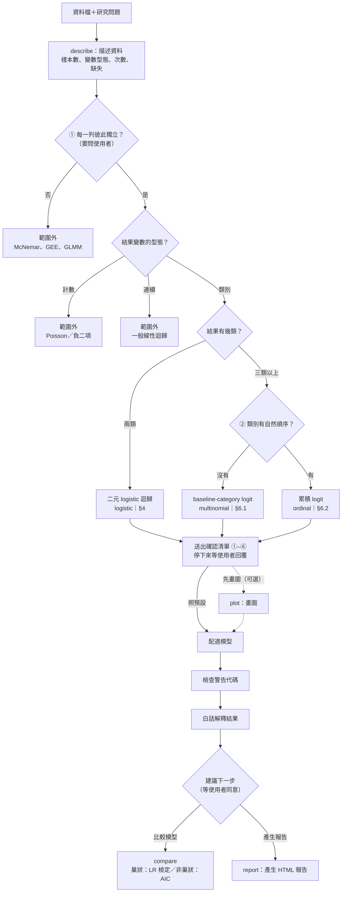

# categorical-modeling

**直接線上看（不用下載）：**
[Part 2 報告](https://r26141104.github.io/categorical-modeling/report/modeling.html)｜[Skill 介紹](https://r26141104.github.io/categorical-modeling/skill-overview.html)｜[製作教學](https://r26141104.github.io/categorical-modeling/make-skill-tutorial.html)｜[AI 使用紀錄](https://r26141104.github.io/categorical-modeling/report/ai-usage.html)

**想自己用這個 Skill：** 下載 [categorical-modeling.zip](https://github.com/r26141104/categorical-modeling/raw/main/categorical-modeling.zip)，上傳到 Claude（自訂 → 技能）即可。

一個 Claude Agent Skill：**類別結果變數的模型分析顧問**。使用者提供資料檔和研究問題，
Skill 會判斷該用哪一個模型、說明假設與限制，用 Python（statsmodels）實際配適模型，並以白話解釋勝算比與預測機率；
還能**比較兩個模型**（例如數字代碼當數值還是類別），最後把分析**整理成一份 HTML 報告**。

統計內容依據 **Agresti, A. (2019). *An Introduction to Categorical Data Analysis* (3rd ed.)** 第 4–6 章。

## 涵蓋範圍：3 個模型＋模型比較＋報告

| 結果變數 | 模型 | 教科書 |
|---|---|---|
| 兩類 | 二元 logistic 迴歸 | §4.1–4.6、§5.1–5.3 |
| 三類以上、沒有順序 | baseline-category logit | §6.1 |
| 三類以上、有順序 | 累積 logit（比例勝算模型） | §6.2–6.3 |
| 上面任一種 | 比較兩個模型：概似比檢定、AIC | §4.3、§5.1–5.2 |

範圍外：配對／重複測量／叢集資料、計數結果、連續結果、只檢定兩變數關聯（不建模型）。

## 檔案結構

```text
categorical-modeling/
├── SKILL.md                    # 主檔：觸發條件、行為規則、分析流程
├── references/
│   ├── methods.md              # 三個模型速查：H0、統計量、效果量、對應函式、指令
│   ├── textbook-methods.md     # 課本細節：假設、公式、注意事項（附節號）
│   └── decision-tree.md        # 選模型的決策樹（Phase 0 + 主決策樹）
├── scripts/
│   └── run_model.py            # 實際計算（statsmodels）＋畫圖（matplotlib）＋比較模型＋產生報告
├── data/                       # 範例資料
│   ├── crabs.csv               #   馬蹄蟹（二元 logistic，§4.1）
│   ├── alligators.csv          #   鱷魚主食（baseline-category logit，§6.1）
│   └── student_por.csv         #   葡萄牙高中生（UCI，CC BY 4.0）
├── decision-tree.png           # 決策樹圖
├── skill-overview.qmd / .html  # 介紹本 Skill 的頁面（.html 可直接用瀏覽器打開）
├── make-skill-tutorial.qmd / .html  # 製作教學：規劃、撰寫、測試、修改的完整過程
├── categorical-modeling.zip    # 打包好的 Skill，可直接上傳到 Claude App
├── _nav/                       # 各頁上方的導覽列（Part 2 報告、Skill 介紹、製作教學、AI 使用紀錄）
└── report/                     # Part 2 報告與 Skill 實測紀錄（見下方說明）
```

Skill 採用**分層設計**：`SKILL.md` 精簡且永遠載入；詳細知識放在 `references/`，需要時才讀；
所有數字交給 `scripts/run_model.py` 計算。

## Skill 的行為

- **未經同意不畫圖、不配適、不比較、不產生報告**；資料是否獨立一定讓使用者確認。
- **快速確認清單**：描述資料後，用一則訊息列出所有設定（附預設值與理由）和推薦的模型；點選「照預設配適」就開始，要改只寫編號。
- **用選擇題決定下一步**：每則回覆結尾都會列出 2–4 個選項讓你點選，推薦的選項放在第一個並標「（推薦）」。
- 流程：描述資料＋確認清單 →（先畫圖）→ 配適 → 白話解釋 →（比較模型）→（產生報告）。
- 所有數字都由程式計算，Claude 不自己計算或修改數字。

### 分析流程圖



每個判斷點的理由、使用者不確定時怎麼協助判斷，見 `references/decision-tree.md`。

### 如何對話

直接用自然語言描述需求並上傳資料，不需要知道模型名稱。例如：

> 用 categorical-modeling skill 分析 crabs.csv：背甲寬度（width）和顏色（color）會影響身邊有沒有衛星雄蟹（y）嗎？

> alligators.csv 裡，鱷魚的體長（length）和主食（food）有關嗎？

> 我的結果是滿意度 1–5 分，該用哪個模型？（只問概念，不會開始配適）

### 流程中 Claude 會問你什麼

描述資料後，Claude 會用**一則訊息**列出確認清單，每一項附預設值與理由：

| 編號 | 確認事項 | 說明 |
|---|---|---|
| ① | 每一列是不是不同、彼此獨立的個體 | 資料本身看不出來，一定要你確認 |
| ② | 結果有幾類、有沒有順序 | 決定用哪一個模型 |
| ③ | 數字代碼當數值分數還是類別 | 例如讀書時間 1–4 |
| ④ | 類別型解釋變數的參考組 | 預設排序後第一個類別 |
| ⑤ | 二元結果的成功類別、名目結果的基準類別 | 只改變勝算比的方向 |
| ⑥ | 樣本數是否足夠 | Claude 的檢查結果，不需要你決定 |

清單後面會出現選擇題：點「**照預設配適（推薦）**」就開始配適，點「**先畫圖**」先看圖；要改設定就選「其他」，寫編號和新設定，例如「③ failures 改當類別」。

之後每一步（解釋結果、比較模型、產生報告）的結尾也都是選擇題，推薦哪一個依固定規則決定，例如出現 `PO_VIOLATED` 時推薦「配適 multinomial 當對照」。

### 三種工作模式

| 模式 | 說明 |
|---|---|
| 完整分析 | 從描述資料、確認清單一路做到解釋結果 |
| 只問概念或單一步驟 | 例如「勝算比怎麼解釋」，直接回答，不跑完整流程 |
| 接續分析 | 同一個對話已確認的設定直接沿用，不重複詢問 |

### 計算方式與驗證

計算用 Python（statsmodels），在 Claude 的雲端環境就能直接執行，不需要另外安裝 R。
為了確認數字正確，另外用 R（`glm`、`MASS`、`ordinal`、`nnet`）獨立重算，結果和 Skill 一致（見 `report/verify.R`）。

## scripts/run_model.py

需要 Python 3 與 `numpy`、`pandas`、`scipy`、`statsmodels`、`matplotlib`。在 Claude App 裡執行時，缺少的套件 Skill 會自動安裝：

```bash
pip install numpy pandas scipy statsmodels matplotlib
```

```bash
# 描述資料、畫圖
python scripts/run_model.py describe    --csv data.csv --vars y,a,b
python scripts/run_model.py plot        --csv data.csv --y y --x a

# 三個模型（結果寫到 --out 資料夾：result.json + 圖）
python scripts/run_model.py logistic    --csv data.csv --y pass --x a,b --success pass --numeric a
python scripts/run_model.py multinomial --csv data.csv --y reason --x a,b --baseline other
python scripts/run_model.py ordinal     --csv data.csv --y rating --x a --levels 1,2,3,4,5

# 比較兩個模型：模型 A 用 --x、--numeric，模型 B 用 --x2、--numeric2（沒給就沿用 A）
python scripts/run_model.py compare     --type logistic --csv data.csv --y pass --x a,b --numeric a,b --numeric2 b --success pass

# 產生報告：把多個結果資料夾整理成一份 HTML
python scripts/run_model.py report      --out output/q1,output/q1_compare --summary summary.md --file output/report.html
```

| 選項 | 意義 |
|---|---|
| `--x` | 解釋變數，多個用逗號分隔 |
| `--numeric` | 要當數值分數的變數；沒列的文字或代碼變數都當類別 |
| `--ref` | 類別型解釋變數的參考類別，例如 `--ref sex=F,school=GP` |
| `--success` | 二元結果的成功類別（決定勝算比方向） |
| `--baseline` | 名目結果的基準類別 |
| `--levels` | 有序結果由低到高的順序 |
| `--out` | 輸出資料夾（預設 `output`）；`report` 時是要整理的結果資料夾（逗號分隔） |
| `--type` | `compare` 的模型種類：`logistic`、`multinomial`、`ordinal` |
| `--x2`、`--numeric2` | `compare` 的模型 B；`--numeric2 none` 代表全部當類別 |
| `--title`、`--summary`、`--file` | `report` 的標題、結論摘要檔（Markdown 文字）、輸出檔名 |

## 安裝

### Claude App（網頁版、桌面版）

1. **Settings → Capabilities**：確認「程式碼執行與檔案建立」（Code execution and file creation）已開啟
2. **Customize → Skills**：按 **＋** → **Create skill** → **Upload a skill**
3. 上傳 `categorical-modeling.zip`（ZIP 裡的資料夾名稱必須是 `categorical-modeling`）
4. 在 Skill 清單中確認已開啟，開一個新對話，上傳資料檔後提問，例如：
   「用 categorical-modeling skill 分析這份資料：哪些因素會影響是否及格？」

### Claude Code

把整個資料夾複製到 `<你的專案>/.claude/skills/categorical-modeling/`，
或個人層級的 `~/.claude/skills/categorical-modeling/`（Windows：`C:\Users\<帳號>\.claude\skills\`）。

## Part 2 報告與 Skill 實測（report/）

**從 `report/modeling.html` 開始看**：上方選單可以切換到 Skill 介紹、製作教學、AI 使用紀錄。

本 Skill 是「類別資料分析」課程分組報告中 **Part 2：Modeling Categorical Outcomes** 的作品。

| 檔案 | 內容 |
|---|---|
| `modeling.html` | Part 2 報告網頁（單一檔案，下載後用瀏覽器打開即可） |
| `modeling.qmd` | 網頁原始檔（需搭配小組專案的共用程式才能重新產生） |
| `ai-usage.qmd`、`ai-usage.html` | AI 使用紀錄頁（由 `ai-log.csv` 整理） |
| `judgment.yml` | 實測前依課本做的人為判斷：每題的資料結構、變數型態、模型與理由 |
| `verify.R`、`verify_results.json` | 用 R（`glm`、`MASS`、`ordinal`、`nnet`）獨立重算的驗證程式與結果 |
| `skill-test/` | 在 Claude 桌面版新對話中實測本 Skill 的輸出：三題的 `result.json`、圖、確認問題截圖、完整對話紀錄 `transcript.md` |
| `skill-test/round2/` | 第二次實測（確認清單、模型比較、產生報告）：`result.json`、Skill 產生的 `report.html`、截圖、對話紀錄 |
| `skill-test/round3/` | 第三次實測（改版後的決策樹、工作模式、選擇題）：測試紀錄 `record.md`、對話紀錄 `transcript.md`、截圖 |
| `ai-log.csv` | 製作過程的 AI 使用紀錄 |

**實測結果**：三題（二元、有序、名目結果）Skill 選的模型都和人為判斷一致；21 項數字和 R 驗證程式全部一致。
第二次實測加入模型比較：被當次數當類別明顯比當數值好（LR = 9.53，df = 2，P = 0.009），6 項數字和 R 一致。
第三次實測檢查改版後的行為（協助判斷順序、同校資料的提醒、`PO_VIOLATED` 建議 multinomial 對照、接續分析不重問、不獨立就停止、結尾用選擇題並標記推薦），五個測試全部符合預期，數字和第一次實測完全相同。
實測時發現的問題（看圖估讀比例、回覆次數太多、無法檢查等距假設、重複選項被忽略）都已修正。

## 參考文獻

Agresti, A. (2019). *An Introduction to Categorical Data Analysis* (3rd ed.). Wiley.

Cortez, P., & Silva, A. (2008). Using data mining to predict secondary school student performance. UCI Machine Learning Repository. https://doi.org/10.24432/C5TG7T
