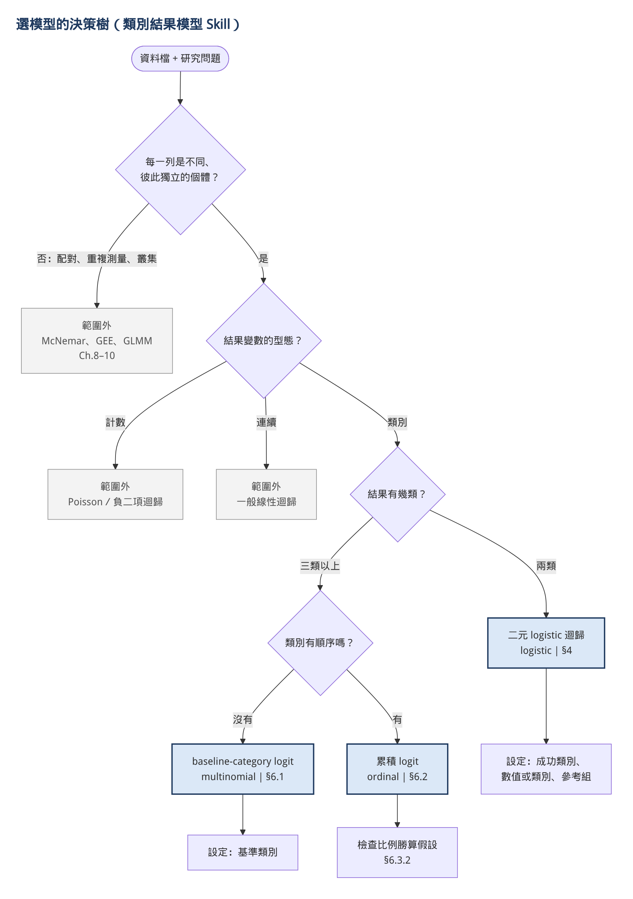
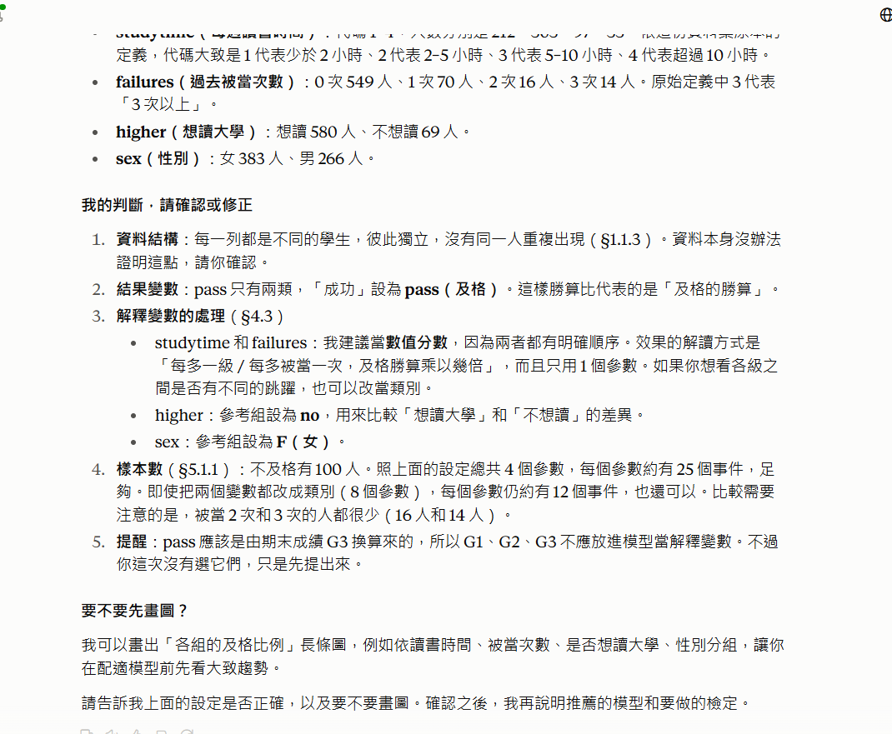
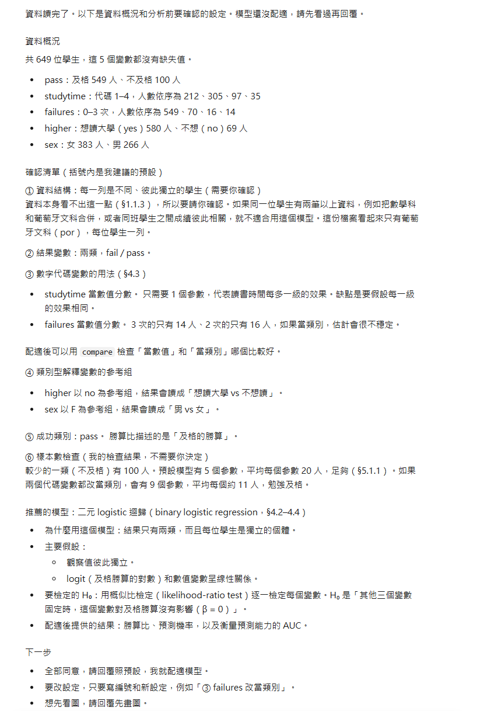
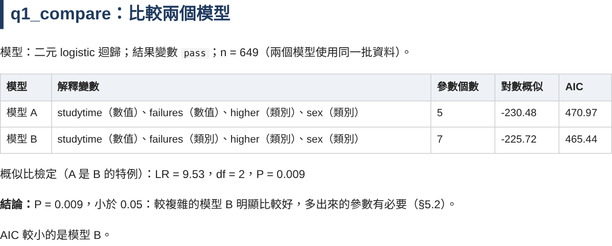

# Skill 是什麼

Skill 是一個資料夾，裡面放著「教 Claude 怎麼做某件事」的說明文件與程式。把資料夾壓成 zip 上傳到 Claude App 之後，Claude 在對話中碰到相關的需求，就會自動讀取這份說明並照著做。

一般對話中，Claude 會用自己的方式回答：自己挑模型、自己決定要不要畫圖、甚至自己估算數字。Skill 的用途是**把做法固定下來**。在本例中，我們要求 Claude：

- 先問清楚資料結構與變數型態，**不自己替使用者決定**
- 只在三個類別結果模型中選擇，範圍外的問題要明說
- **所有數字都由 Skill 內的程式計算**，不可以心算或估計

## Skill 的資料夾結構

一個 Skill 只有 `SKILL.md` 是必要的，其他資料夾依需要加入：

| 名稱 | 是否必要 | 用途 |
|---|---|---|
| `SKILL.md` | 必要 | 開頭的 `name`、`description` 決定何時啟用；本文寫工作流程 |
| `references/` | 選用 | 參考資料，Claude 需要時才讀 |
| `scripts/` | 選用 | 可執行的程式，負責每次結果都要一樣的計算 |
| `data/` 等其他檔案 | 選用 | 範例資料、圖檔等 |

## Progressive disclosure：為什麼要分這麼多檔案

Claude 讀 Skill 的方式分三層：

1. **`name` 與 `description`**：永遠在 Claude 的記憶中，用來判斷「現在要不要用這個 Skill」。
2. **`SKILL.md` 本文**：Skill 被啟用時才讀。
3. **`references/` 與 `scripts/`**：本文中指定「什麼時候讀哪個檔案」，用到時才讀。

這種設計稱為 progressive disclosure（逐步揭露）。好處是 Claude 不會一次讀入大量用不到的內容。例如使用者只做二元 logistic 迴歸時，Claude 不需要讀累積 logit 的比例勝算檢定細節。

# 本例 Skill 的檔案結構與功能

## 檔案分支圖

```
categorical-modeling/
├── SKILL.md
├── references/
│   ├── decision-tree.md
│   ├── methods.md
│   └── textbook-methods.md
├── scripts/
│   └── run_model.py
├── data/
│   ├── crabs.csv
│   ├── alligators.csv
│   └── student_por.csv
└── decision-tree.png
```

## 各檔案功能

| 檔案 | 何時被讀取 | 功能 |
|---|---|---|
| `SKILL.md` | Skill 啟用時 | 定義範圍（3 個模型＋模型比較＋報告）、行為規則（未經同意不計算、確認清單）、六個步驟的回答流程、警告代碼的說明方式 |
| `references/decision-tree.md` | 步驟 1（確認清單、選模型）、步驟 4（建議比較） | Phase 0 先確認資料是否獨立與結果型態，再依「幾類、有沒有順序」選模型；列出要問使用者的設定；配適後建議做哪些模型比較 |
| `references/methods.md` | 需要速查時 | 每個模型與模型比較的式子、H₀、統計量、效果量、對應的 Python 與課本 R 函式、指令 |
| `references/textbook-methods.md` | 步驟 4–5（解釋、比較） | 每個模型的完整假設、參數意義、推論方式、模型檢查、模型比較與常見誤解（附 Agresti 節號） |
| `scripts/run_model.py` | 步驟 1–6 | `describe` 描述資料、`plot` 畫圖並印出比例、`logistic`／`multinomial`／`ordinal` 配適模型、`compare` 比較兩個模型、`report` 產生 HTML 報告 |
| `data/` | 試用時 | 課本範例（馬蹄蟹、鱷魚）與真實資料（葡萄牙高中生） |
| `decision-tree.png` | 介紹用 | 決策樹的圖檔版本 |

## Skill 執行流程

```{mermaid}
flowchart TD
    A[使用者上傳資料並提問] --> B[步驟 1: describe 描述資料<br/>一則確認清單: 設定附預設值＋推薦模型]
    B --> C{使用者回覆}
    C -->|先畫圖| D[步驟 2: plot 畫圖<br/>印出各組實際比例]
    D --> C
    C -->|照預設／改設定| E[步驟 3: run_model.py 配適模型<br/>輸出 result.json 與圖]
    E --> F[步驟 4: 白話解釋<br/>勝算比、預測機率、警告代碼<br/>建議可以做的比較]
    F --> G{使用者回覆}
    G -->|比較模型| H[步驟 5: compare<br/>概似比檢定、AIC]
    H --> G
    G -->|產生報告| I[步驟 6: 寫結論摘要<br/>report 產生 HTML 報告]
    G -->|下一題| B
```

# 製作步驟

## 步驟一：規劃範圍與流程

### 決定範圍

本 Skill 只處理我負責的 Part 2：**結果變數是類別**的三個迴歸模型。

| 結果變數 | 模型 | 指令 |
|---|---|---|
| 兩類 | 二元 logistic 迴歸 | `logistic` |
| 三類以上、沒有順序 | baseline-category logit | `multinomial` |
| 三類以上、有順序 | 累積 logit（比例勝算模型） | `ordinal` |
| 上面任一種 | 比較兩個模型（概似比檢定、AIC） | `compare` |
| — | 把分析結果整理成 HTML 報告 | `report` |

`compare` 和 `report` 是第一次實測之後才加的，原因見步驟八。

範圍外的情況在 `SKILL.md` 中明確列出，要求 Claude 說明原因並告知適合的方法，**不要硬套**：

- 同一個體有多筆資料（配對、重複測量、叢集）：屬於 Part 3 的內容
- 結果是計數：Poisson 迴歸
- 結果是連續數值：一般線性迴歸
- 只想看兩個類別變數有沒有關聯：列聯表與卡方檢定，屬於 Part 1 的內容

範圍越清楚，Claude 越不會自己發揮。

### 決定流程

我們希望 Skill 的使用方式像真正和統計顧問討論一樣：

1. 拿到資料先描述，問清楚研究目的。
2. **資料是否獨立一定要問**，因為從資料本身看不出來。
3. 數字代碼（例如讀書時間 1–4）要當數值還是類別、參考組是哪一類，這些都會改變結論，**讓使用者決定**。
4. 推薦模型後**等使用者同意**才計算。

### 判斷例子刻意不用實測題目

`decision-tree.md` 裡的判斷例子全部用課本資料（馬蹄蟹、鱷魚、政治意識形態），**不用之後要實測的三題**。如果事先把答案寫進 Skill，實測時 Skill 判斷正確就沒有意義了。

## 步驟二：撰寫 `SKILL.md`

### Frontmatter：`name` 與 `description`

```yaml
---
name: categorical-modeling
description: >-
  類別結果變數的模型分析顧問（modeling categorical outcomes）。
  當使用者的結果變數是類別（兩類、多類、有序），想知道一個或多個解釋變數的影響、預測機率，
  或明確提到 logistic 迴歸、logit、勝算比 odds ratio、多元 logistic、multinomial、
  baseline-category logit、ordinal logistic、累積 logit、cumulative logit、proportional odds、
  比例勝算、ROC、AUC、模型比較、AIC 時，使用本 skill ……
---
```

- `name` 必須和資料夾名稱相同（`categorical-modeling`），上傳時才不會出錯。
- `description` 是 Claude 判斷「要不要啟用」的唯一依據，所以要寫兩種觸發情境：
  - **一般使用者的說法**：「結果是類別，想知道哪些因素有影響」
  - **懂統計的人會用的關鍵字**：中英文術語都列，例如「勝算比 odds ratio」「累積 logit」

### 本文的結構

| 段落 | 內容 |
|---|---|
| 涵蓋範圍 | 3 個模型＋模型比較＋報告的表格，以及範圍外的處理方式 |
| **行為限制（最優先）** | 5 條規則，寫在流程前面，並標明「凌駕下方流程」 |
| 回答流程 | 步驟 1–6，每一步寫清楚要執行哪個指令、要問什麼、結尾要給使用者哪些選項 |
| 警告代碼 | 程式輸出的每種警告，要怎麼用白話向使用者說明 |
| 溝通風格 | 繁體中文、先給結論、術語附英文、附教科書節號 |

### 行為限制

這是整個 Skill 最重要的部分：

1. **未經使用者明確同意，絕對不要配適任何模型、畫圖、比較模型或產生報告。**
2. **資料是否獨立一定要讓使用者確認**，不可以自行假設後直接計算。
3. 使用者沒要求的模型、檢定或比較，不要「順便」多做；可以建議，但要等同意。
4. **所有數字都由 `scripts/run_model.py` 計算**，絕不心算或憑空給數字；描述圖形時只能引用程式印出的比例。
5. 每則訊息結束時，清楚告訴使用者「回覆什麼就會做什麼」，然後停下來等回覆。

規則寫成「不要做什麼」比寫「要做什麼」更有效。只寫「先描述資料」的話，Claude 很可能描述完就順手把模型也跑完。

一開始的規則是「一次只做一步」，實測後發現回覆次數太多，改成用一則**確認清單**列出所有設定（見步驟八）。

### 警告代碼表

程式偵測到問題時會輸出警告代碼，`SKILL.md` 規定每種代碼要怎麼說明：

| 代碼 | 要怎麼說明 |
|---|---|
| `SEPARATION` | 估計值其實是無限大，係數、標準誤、Wald 檢定沒有意義，改看概似比檢定 |
| `FEW_EVENTS` | 樣本相對參數太少，估計可能有偏誤、不穩定 |
| `GOF_NOTE` | 有數值解釋變數時，deviance 不能當適合度檢定 |
| `PO_VIOLATED` | 比例勝算假設不成立，單一勝算比可能過度簡化；**不要**建議把結果壓成兩類 |
| `NOT_NESTED` | 兩個模型不是巢狀，不能用概似比檢定，只能比較 AIC |
| `MISSING` | 排除了幾筆缺失資料；只有缺失完全隨機時才不會造成偏誤 |

判斷「有沒有問題」交給程式，「怎麼解釋」交給 Claude。這樣警告不會因為 Claude 疏忽而漏掉，解釋也能配合使用者的問題。

## 步驟三：撰寫 `references/`

三個檔案分別對應不同的深度，Claude 依需要讀取：

### `decision-tree.md`：選模型

- **Phase 0**：任何模型之前，先確認三件事：資料是否獨立、結果是什麼型態、是不是真的要建模型。任何一項不符合就是範圍外。
- **主決策樹**：結果幾類 → 有沒有順序 → 對應的模型。
- **選好模型後還要確認的設定**：成功類別、數字代碼的用法、參考類別、基準類別、類別順序。每一項都附上「怎麼問使用者」的範例句。

{width=75%}

### `methods.md`：速查卡

每個模型一張表：模型式、H₀、統計量與分配、效果量、信賴區間、對應的 Python 函式、課本的 R 函式、`run_model.py` 指令。最後是三個模型共用的決策規則（LR ≥ χ²(df, α) 臨界值 時拒絕 H₀）。

### `textbook-methods.md`：課本細節

每個模型的完整內容：假設、參數的意義、最大概似估計、推論方式、模型檢查（適合度、ROC、完全分離、比例勝算假設）、常見誤解。每一項都標出 Agresti 的節號，方便查證。

## 步驟四：撰寫 `scripts/run_model.py`

### 指令設計

| 指令 | 做什麼 | 輸出 |
|---|---|---|
| `describe` | 變數型態、次數、缺失值、可能不獨立的跡象 | 畫面摘要 |
| `plot` | 結果變數依解釋變數分組的比例長條圖，**同時印出各組實際比例** | PNG＋畫面摘要 |
| `logistic` | 勝算比與 profile 信賴區間、LR 檢定、AUC、預測機率 | `result.json`、預測機率曲線、ROC 曲線 |
| `multinomial` | 各方程式的勝算比、LR 檢定、預測機率 | `result.json`、各類別預測機率圖 |
| `ordinal` | 較高類別的勝算比、LR 檢定、**比例勝算假設檢定** | `result.json`、各類別預測機率圖 |
| `compare` | 比較兩個模型：巢狀時做概似比檢定，否則只比較 AIC | `result.json` |
| `report` | 把多個結果資料夾整理成一份 HTML 報告 | `report.html` |

使用者在確認清單做的決定，都對應到一個選項，Claude 照使用者的回答填入即可：

| 選項 | 對應的使用者決定 |
|---|---|
| `--numeric` | 哪些數字代碼要當數值分數 |
| `--ref` | 類別型解釋變數的參考組，例如 `--ref sex=F,higher=no` |
| `--success` | 二元結果的成功類別（決定勝算比方向） |
| `--baseline` | 名目結果的基準類別 |
| `--levels` | 有序結果由低到高的順序 |
| `--x2`、`--numeric2` | `compare` 的第二個模型（例如 `--numeric2 none` 代表全部當類別） |

### 設計決定

- **輸出 `result.json`**：除了畫面上的摘要，所有數字都存成固定格式的檔案。實測時，網頁可以直接讀這個檔案和驗證程式的結果比對，不用人工抄數字。
- **警告由程式判斷**：完全分離、樣本太少、比例勝算假設不成立等，程式偵測到就輸出警告代碼（見步驟二）。
- **比例勝算假設檢定**：比較「各切點共用一組係數」與「每個切點各自一組係數」的兩個模型，用概似比檢定。

### 用課本例題測試

每個指令都先用課本例題跑一次，確認數字和課本一致：

| 例題 | 模型 | 比對的數字 | 結果 |
|---|---|---|---|
| 馬蹄蟹：背甲寬度 → 有沒有衛星雄蟹 | logistic | β̂ = 0.497、LR = 31.31、勝算比 95% CI 1.361–2.032 | 與課本一致 |
| 鱷魚：體長 → 主食 | multinomial | β̂ = −2.465、LR = 16.80 | 與課本一致 |
| 馬蹄蟹：顏色當數值 vs 當類別 | compare | LR = 1.66、df = 2、P = 0.435 | 與 R 的 `anova()` 一致 |

以馬蹄蟹為例，程式的輸出如下：

```bash
python scripts/run_model.py logistic --csv data/crabs.csv --y y --x width --numeric width
```

```
【二元 logistic 迴歸】結果變數 y，成功類別 = 1；n = 173（成功 111）
整體檢定（所有解釋變數 vs 只有截距）：LR = 31.31，df = 1，P < 0.001

係數與勝算比（信賴區間：profile likelihood）
- width（每增加 1）：β = 0.497（SE 0.102），勝算比 = 1.644，95% CI 1.361 – 2.032，Wald P < 0.001

預測能力：AUC = 0.742

注意事項
- [GOF_NOTE] 模型含數值解釋變數，deviance 不能當適合度檢定；……
```

### 測試時發現的問題：完全分離時程式當掉

另外故意做了一份「完全分離」的資料（某個解釋變數可以完美區分兩類結果），確認程式會發出 `SEPARATION` 警告。結果程式直接當掉：估計值非常大，計算勝算比 e^β 時數值溢位（`OverflowError`）。

**修正**：計算勝算比時改用安全的指數函式，數值太大時回傳無限大，不會讓程式中斷。修正後，程式能正常輸出結果並附上 `SEPARATION` 警告。

## 步驟五：打包並上傳到 Claude App

### 打包

把整個 `categorical-modeling` 資料夾壓縮成 `categorical-modeling.zip`。**zip 打開後的第一層必須是這個資料夾**，而且資料夾名稱要和 `SKILL.md` 的 `name` 相同。

### 上傳

1. **設定 → 功能（Capabilities）**：確認「程式碼執行與檔案建立」已開啟。Skill 要執行 `run_model.py`，沒開就無法計算。
2. **自訂（Customize）→ 技能（Skills）**：按 **＋** → **建立技能** → **上傳技能**。
3. 選擇 `categorical-modeling.zip`。
4. 在技能清單中確認 `categorical-modeling` 已開啟。

### 上傳時遇到的狀況

| 狀況 | 原因 | 解決方式 |
|---|---|---|
| 選檔視窗點兩下 zip 後跑進 zip 裡面，選不到檔案 | Windows 把 zip 當成資料夾打開 | 在 zip 上**點一下**後按「開啟」，或直接把 zip 拖進上傳視窗 |
| 修改後要重新上傳 | 舊的 Skill 還在技能清單裡 | 刪除舊的，或上傳後確認清單中是修改後的內容 |

## 步驟六：用真實資料實測

### 測試的設計

課本例題只能證明「程式算得對」，不能證明「Skill 會用」。所以另外用真實資料，模擬一般使用者的提問方式來測試。

- **資料**：UCI 葡萄牙高中生資料（649 位學生），三題研究問題，剛好各對應一個模型
- **人為判斷先做**：實測前，我自己依課本判斷每一題的資料結構、變數型態、該用的模型與理由，記在 `report/judgment.yml`
- **在全新的對話中測試**：在 Claude 桌面版開新對話，上傳資料，用一般說法提問，例如：

  > 用 categorical-modeling skill 分析這份資料：讀書時間（studytime）、被當次數（failures）、想不想讀大學（higher）、性別（sex），哪些會影響是否及格（pass）？

- **獨立驗證**：另外用 R 照課本的做法重算（`report/verify.R`，使用 `glm`、`MASS::polr`、`ordinal::clm`、`nnet::multinom`），不經過 Skill 的程式

| 題目 | 結果變數 | 人為判斷的模型 |
|---|---|---|
| q1：哪些因素會影響是否及格？ | pass（兩類） | 二元 logistic |
| q2：男生和女生的週末飲酒量不同嗎？ | Walc（1–5，有序） | 累積 logit |
| q3：居住地和學校跟選校原因有關嗎？ | reason（4 類，沒有順序） | baseline-category logit |

### 測試過程

Skill 確實照當時的規則一步一步進行：先描述資料，列出判斷請我確認，問要不要畫圖，推薦模型後等我說「好」才計算。

{width=85%}

實際使用時發現，**每一步都要回覆，次數有點多**。比較有效率的做法是把確認的內容合併成一則訊息，例如：

> 設定都正確，每位學生只出現一次、彼此獨立。studytime 和 failures 當數值分數。要畫圖。

> 不用改模型，先這樣。接下來第 3 題：……每位學生彼此獨立，基準類別用 other，不用畫圖。

完整的對話紀錄在 `report/skill-test/transcript.md`。

### 測試結果

| 檢查項目 | 結果 |
|---|---|
| 模型判斷：Skill 選的模型和人為判斷相同嗎？ | **3 題全部相同** |
| 數字：Skill 的結果和 R 獨立重算相同嗎？ | **21 項全部一致** |
| 是否主動提醒限制？ | 有。例如提醒 pass 由期末成績換算，G1–G3 不能當解釋變數；第 2 題比例勝算假設不成立（`PO_VIOLATED`）時，說明單一勝算比只代表平均效果，沒有建議把結果壓成兩類 |

## 步驟七：發現問題與修改

### 發現的問題

第 1 題畫完長條圖後，Skill 說出了各組的不及格比例，並註明「數字是從長條高度估讀的」：

> 沒被當過的學生不及格比例不到 10%，被當過 1 次就跳到約 46%，2 次約 50%，3 次以上約 64%。

估讀的數字其實很接近，但這**違反了「所有數字都由程式計算」的規則**。原因是原本的 `plot` 指令只輸出圖檔，Claude 手上沒有確切的數字，只好看圖估計。

### 解決方式

| 檔案 | 修改 |
|---|---|
| `scripts/run_model.py` | `plot` 指令畫圖時，同時在畫面印出各組的實際比例 |
| `SKILL.md` | 步驟 2 加上：描述圖形時**只能引用這些印出的數字，不可從圖上估讀** |

修改後的 `plot` 輸出：

```
pass 依 failures 分組的比例（每一列合計 100%；圖上的數字一律以這張表為準）
- failures = 0（n = 549）：fail 9.3%、pass 90.7%
- failures = 1（n = 70）：fail 45.7%、pass 54.3%
- failures = 2（n = 16）：fail 50.0%、pass 50.0%
- failures = 3（n = 14）：fail 64.3%、pass 35.7%
```

### 修改後的測試

重新打包、上傳修改後的 Skill，在新對話中再請 Skill 畫同一張圖。這次 Skill 引用的是程式印出的確切比例（9.3%、45.7%、50.0%、64.3%），不再估讀。

| failures | 修改前（看圖估讀） | 修改後（程式計算） |
|---|---|---|
| 0 | 不到 10% | 9.3% |
| 1 | 約 46% | 45.7% |
| 2 | 約 50% | 50.0% |
| 3 | 約 64% | 64.3% |

## 步驟八：實測後新增功能

### 為什麼要加

第一次實測除了看圖估數字，還留下三個問題：

| 實測時的狀況 | 問題 | 新增的功能 |
|---|---|---|
| 第 1 題要回覆好幾次才開始計算 | 一步一問，回覆次數太多 | **確認清單**：設定一次列出、附預設值 |
| Skill 提醒 failures 的效果集中在「0 次 → 1 次」，等距假設可能不成立 | 有提醒，卻沒辦法檢查 | **`compare`**：比較兩個模型 |
| 分析結果散在對話裡 | 不方便整理、交給別人 | **`report`**：產生 HTML 報告 |

### 確認清單

`SKILL.md` 的步驟 1 改成：描述資料後，用**一則訊息**依序寫出資料概況、編號的確認清單（每項附預設值與理由）、推薦的模型，最後固定用三行結尾：

- 「全部同意，請回覆**照預設**，我就配適模型。」
- 「要改設定，只要寫編號和新設定，例如『③ failures 改當類別』。」
- 「想先看圖，請回覆**先畫圖**。」

「未經同意不計算」的規則不變：使用者回覆「照預設」，就是同意訊息中**明確寫出**要做的事。只有「資料是否獨立」不能用預設值帶過，清單中一定標明「請你確認」。

### `compare`：比較兩個模型

```bash
python scripts/run_model.py compare --type logistic --csv 資料.csv --y pass \
  --x studytime,failures,higher,sex --numeric studytime,failures --numeric2 studytime --success pass
```

- 模型 A 用 `--x`、`--numeric`，模型 B 用 `--x2`、`--numeric2`（沒給就沿用 A）
- 程式自動判斷兩個模型是不是**巢狀**：數值分數是類別的特例、少一個變數的模型是完整模型的特例
- 巢狀時做概似比檢定並給出結論；不是巢狀時發出 `NOT_NESTED` 警告，只比較 AIC
- 兩個模型一律使用**同一批觀察值**（依兩個模型的所有變數一起排除缺失值）

### `report`：產生 HTML 報告

```bash
python scripts/run_model.py report --out output/q1,output/q1_compare \
  --title "報告標題" --summary summary.md --file output/report.html
```

- 表格、圖、注意事項都由程式從 `result.json` 產生
- 結論摘要 `summary.md` 由 Claude 撰寫，`SKILL.md` 規定**只能使用程式輸出的數字**

### 用 R 驗證新功能

`compare` 的數字另外用 R 的 `glm()`、`anova()`、`AIC()` 重算（加在 `report/verify.R`）：

| 比較 | Skill（Python） | R |
|---|---|---|
| failures 當數值：對數概似、AIC | −230.48、470.97 | −230.48、470.97 |
| failures 當類別：對數概似、AIC | −225.72、465.44 | −225.72、465.44 |
| 概似比檢定 | LR = 9.53、df = 2、P = 0.0085 | LR = 9.53、df = 2、P = 0.0085 |

### 第二次實測

**實測前先寫下人為判斷**（記在 `report/judgment.yml`）：

> failures 當數值比較好，因為它並不是一個 0 或 1 的答案。

接著換上新的 Skill，在**新對話**中重新問第 1 題，依序回覆：

1. 「每位學生彼此獨立。studytime 和 failures 當數值分數，其他照預設。」
2. 「好，比較 failures 當數值和當類別。」
3. 「產生報告。」

{width=85%}

| 檢查項目 | 結果 |
|---|---|
| 確認清單 | 一則訊息列出 ①–⑥ 與推薦模型；**回覆 1 次**就開始計算（第一次實測要回覆 2 次） |
| 配適結果 | 和第一次實測、R 驗證完全相同 |
| 建議比較 | Skill 主動建議檢查 failures、studytime 的等距假設，以及拿掉不顯著的 sex，但**等同意才做** |
| 模型比較 | failures 當類別明顯較好（LR = 9.53、df = 2、P = 0.009），和 R 一致 |
| 報告 | 結論摘要裡的每個數字，都能在程式輸出中找到 |

**人為判斷 vs 資料的檢定結果**：我原本認為當數值比較好，但檢定顯示當類別明顯較好。數值分數假設「每多被當一次，效果都一樣」；資料卻顯示「沒被當過 → 被當過一次」的落差，遠大於之後每多被當一次的差別。這是只憑直覺容易忽略、需要用檢定確認的地方。

{width=85%}

完整對話紀錄、`result.json` 與報告在 `report/skill-test/round2/`。

### 從對話紀錄發現的問題：重複的選項

檢查對話紀錄時發現，Skill 下的指令把參考組寫成兩個選項：

```bash
--ref higher=no --ref sex=F
```

原本的程式遇到同一個選項給兩次，只會保留最後一個（`sex=F`）。這次 higher 的預設剛好就是 no，所以結果沒錯，但換成別的資料就可能用錯參考組。

**修正**：重複的選項全部合併（等同 `--ref higher=no,sex=F`）。用同一個指令重跑，結果和實測完全相同；把參考組改成 `--ref higher=yes --ref sex=M` 時，兩個設定也都會套用。

# 重點整理

- **Skill 的核心是行為規則**：未經同意不計算、資料是否獨立一定要問、數字一律交給程式。規則寫成「不要做什麼」最有效。
- **分工清楚**：判斷「有沒有問題」交給程式（警告代碼），「怎麼解釋」交給 Claude。
- **兩種測試都要做**：課本例題確認程式算得對；真實資料實測確認 Skill 會用，而且要和人為判斷、獨立計算比對。
- **實測一定會找到問題**：看圖估數字、回覆次數太多、沒辦法檢查等距假設、重複選項被忽略，都是實測後才發現；修改程式與規則後再測一次才定案。

# 附錄：同學如何使用這個 Skill

1. 從 GitHub 下載 `categorical-modeling.zip`（**不用解壓縮**）。
2. 在 Claude App 照步驟五上傳。
3. 開一個新對話，上傳資料檔（csv 或 xlsx），用平常的說法提問，例如：

   > 用 categorical-modeling skill 分析這份資料：哪些因素會影響是否及格？

4. Skill 會用一則確認清單列出所有設定，同意就回「**照預設**」，要改只寫編號。
5. 分析完可以回「**比較……**」檢查模型，或回「**產生報告**」下載 HTML 報告。
6. 想先試用的話，可以用 zip 裡 `data/` 的範例資料（馬蹄蟹、鱷魚、葡萄牙高中生）。
