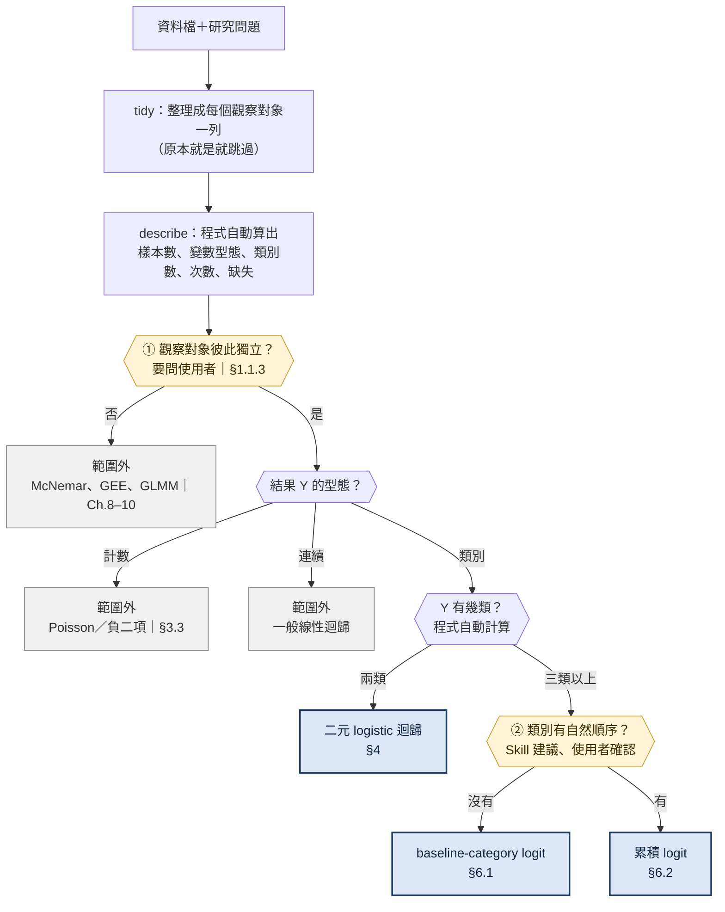
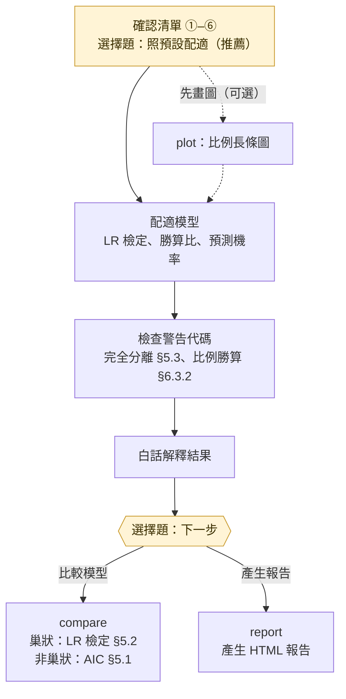

# 選模型的決策樹與必要澄清

依據：Agresti (2019) 第 1、4–6 章。圖檔版本：`decision-tree.png`。

本檔在兩個時間點使用：

- **步驟 1（送出確認清單之前）**：判斷資料能不能用本 Skill、該用哪個模型、還要問使用者哪些設定。
- **步驟 4–5（配適之後）**：依警告代碼與結果，決定要**建議**哪些比較（只建議，等使用者同意）。

流程圖是下方規則的視覺摘要。圖中每個「問使用者」的節點，都要等使用者回覆；資料本身看不出來的事情不可以自行猜測。

## 流程圖

流程分成兩段：**A 選模型**決定用哪一個模型，三個模型都接到 **B 分析流程**。

### A　選模型

### B　分析流程

圖例：藍色 = 本 Skill 的三個模型；灰色 = 範圍外，說明原因後停止；黃色 = 要問使用者或停下來等使用者選擇；虛線 = 可選的步驟。

流程圖只畫主幹，細節在下方各節：

| 流程圖的步驟 | 細節在哪一節 |
|---|---|
| tidy、① 是否獨立、結果變數的型態 | Phase 0；資料格式見「資料格式」；使用者不確定時見「協助使用者判斷」 |
| 結果有幾類、② 有沒有順序 | 主決策樹；使用者不確定時見「協助使用者判斷」 |
| 確認清單 ①–⑥ | 必須先問的事項 |
| 檢查警告代碼 | 配適之後：警告代碼與下一步 |
| 比較模型 | 配適之後：要不要比較模型 |

## Phase 0：先確認資料（任何模型之前）

| 問題 | 為什麼要問（理論） | 答案 → 下一步 |
|---|---|---|
| 1. 每個觀察對象（人、動物……）是不是只出現一次、彼此獨立？ | 三個模型的概似函數都是「每一列的機率相乘」，前提是觀察值獨立（§1.1.3）。同一個體的多筆資料彼此相關，照獨立處理會**低估標準誤**，P 值與信賴區間都過度樂觀 | 否 → 範圍外（McNemar、GEE、GLMM，Ch.8–10）；是 → 繼續 |
| 2. 有沒有要建模型？ | 只檢定兩個類別變數的關聯，列聯表就能回答，不需要迴歸模型（Ch.2） | 只看關聯 → 範圍外；要同時看多個變數、估計效果或預測機率 → 繼續 |
| 3. 結果變數是什麼型態？ | logit 模型描述的是「落在某一類的機率」；計數與連續數值的機率分布不同，要用別的模型 | 計數 → Poisson／負二項（§3.3、§7.6）；連續 → 一般線性迴歸；類別 → 繼續 |

`describe` 發現代號欄位（id、學號等）有重複值時，一定要在確認清單中指出，這是「不獨立」的直接證據；沒有重複值也**不代表**獨立，仍然要問。

獨立性問的是**觀察對象**，和資料怎麼排（變數放在欄或列、是不是次數表）無關；排法由下方「資料格式」處理。

## 資料格式：先整理成「每個觀察對象一列」

`run_model.py` 的分析指令都需要「每一列是一個觀察對象、每一欄是一個變數」。使用者的資料是其他格式時，先用 `tidy` 轉換，**不要自己手動改寫資料**：

| 資料長相 | 例子 | 指令 |
|---|---|---|
| 每個觀察對象一列（標準格式） | 每位學生一列，欄位是 sex、studytime、pass | 不用轉換 |
| 每個觀察對象一欄（轉置） | 第一欄是變數名稱，之後每一欄是一位學生 | `tidy --layout transpose` |
| 次數表：每一列是一種組合，附人數 | gender、party、ideology、count | `tidy --layout freq --freq count` |
| 交叉表：列是解釋變數的類別，欄是結果的類別，格子是人數 | 課本 Polviews：gender、party × y1–y5 | `tidy --layout crosstab --keep gender,party --y ideology` |

- `describe` 會提示可能的格式（欄比列多、有 count／次數欄位），但格式最後由你看資料判斷。
- 轉換後在資料概況中說明「原始資料是〈格式〉，已轉成每個觀察對象一列，共 n 筆」，並列出轉換後的欄位，讓使用者確認轉換正確。
- 次數表和交叉表展開後，每個人一列，最大概似估計和直接用次數配適的結果相同（例如 Polviews 用 `tidy` 轉換後配適，勝算比和課本 R 的結果一致）。
- 交叉表的結果類別依原欄位順序排列；有序結果仍要在 ② 確認由低到高的順序。

## 主決策樹：三個模型的差別

結果兩類 → logistic；三類以上且沒有順序 → multinomial；三類以上且有順序 → ordinal（要檢查比例勝算假設，§6.3.2）。

| | logistic | multinomial | ordinal |
|---|---|---|---|
| 模型 | $\text{logit}\,\pi = \alpha + \beta x$ | $\log(\pi_j/\pi_J) = \alpha_j + \beta_j x$ | $\text{logit}\,P(Y \le j) = \alpha_j + \beta x$ |
| 每個解釋變數幾個參數 | 1 | $J-1$（每條方程式各一個） | 1（所有切點共用） |
| 勝算比的意思 | 成功 vs 失敗 | 第 $j$ 類 vs 基準類別 | 落在**較高**類別 vs 較低類別 |
| 要使用者決定的 | 成功類別 | 基準類別 | 由低到高的順序 |
| 額外假設 | logit 對 $x$ 線性 | — | 比例勝算：每個切點的 $\beta$ 都相同 |

## 必須先問的事項（確認清單 ①–⑥）

| 編號 | 設定 | 適用 | 怎麼問使用者 | 預設 | 為什麼重要 |
|---|---|---|---|---|---|
| ① | 資料是否獨立 | 全部 | 「每個觀察對象（例如每位學生）都只出現一次嗎？有沒有同一個人出現兩次以上？」 | 無，一定要問 | 見 Phase 0 |
| ② | 結果的類別數與順序 | 全部 | 不用問有幾類（`describe` 已算出）；直接寫出「Y 有 k 類：……」，再依變數意義**建議**有沒有順序與由低到高的順序，請使用者確認 | 依 `describe` 與變數意義建議，使用者確認 | 決定用 multinomial 還是 ordinal |
| ③ | 數字代碼當數值或類別 | 全部 | 「1–4 的等級要當數值分數（1 個參數、假設等距效果），還是當類別（每類各自估計）？」 | 有序代碼建議當數值，並說明之後可以用 `compare` 檢查；名目代碼一律當類別 | 見下方「數值分數還是類別」 |
| ④ | 參考組 | 類別型解釋變數 | 「類別型解釋變數要拿哪一類當比較基準？」 | 排序後第一個類別 | 只改變勝算比「和誰比」 |
| ⑤ | 成功類別／基準類別 | logistic／multinomial | 「勝算比要描述哪一類的勝算？」「結果的哪一類當比較基準？」 | 成功：1／yes／pass 等肯定的類別，沒有就用排序後第二個；基準：other／其他，沒有就用排序後最後一個 | 只改變勝算比的方向 |
| ⑥ | 樣本數 | 全部 | 不用問，是你的檢查結果 | — | 參數相對樣本太多時，ML 估計有偏誤、不穩定（§5.1.1） |

④⑤ 的預設值一律照抄 `describe` 印出的「程式預設」，不依人數或個人判斷另選，這樣每個人的結果都能互相對照。使用者在提問時已經寫明的設定，清單中標示「依你的說明」，不必再問。

## 協助使用者判斷（使用者不確定時）

使用者不需要先懂模型名稱。先用例子問清楚資料與研究目的，再由你提出建議與理由，讓使用者確認；不要反覆要求使用者回答術語。

### 獨立還是不獨立？

| 資料長相 | 每一列代表什麼 | 獨立嗎 | 處理 |
|---|---|---|---|
| 300 位學生，每人一列 | 不同的人 | 通常是 | 本 Skill |
| 同一批學生的期中、期末各一列 | 同一人不同時間 | 否（重複測量） | 範圍外：GEE、GLMM（Ch.9–10） |
| 同一學生的數學、葡文成績各一列 | 同一人不同科目 | 否 | 範圍外 |
| 配對的病例與對照、夫妻各一列 | 配對資料 | 否 | 範圍外：McNemar、條件 logistic（Ch.8） |
| 10 個班級各 30 位學生，每人一列 | 同班不同人 | 可能相關（同班有共同環境） | 先問資料怎麼抽樣、同班學生的相似性對研究問題重不重要；重要 → 範圍外（GLMM）；使用者說明可以忽略 → 本 Skill，並在限制中註明 |

### 結果有沒有順序？

| 有順序（用 ordinal） | 沒有順序（用 multinomial） |
|---|---|
| 滿意度：非常不滿意 – 非常滿意 | 主食：魚、無脊椎動物、其他 |
| 疼痛程度：無、輕、中、重 | 交通工具：公車、機車、汽車 |
| 意識形態：非常自由 – 非常保守 | 最常做的運動：籃球、羽球、游泳 |
| 教育程度：國中、高中、大學、研究所 | 血型：A、B、AB、O |

判斷方法：問「能不能說 A＜B＜C？把其中兩類對調，研究問題的意思會不會改變？」會改變就是有序。

為什麼要分清楚：有序結果用 ordinal，每個解釋變數只要 1 個參數，比 multinomial 的 $J-1$ 個簡潔，有單調趨勢時檢定力也較高（§6.2）；把有序結果當名目會浪費順序資訊；把名目結果當有序，則強加了沒有意義的順序。

### 數字代碼要當數值分數還是類別？（§4.3）

| | 當數值分數 | 當類別 |
|---|---|---|
| 參數個數 | 1 | 類別數 − 1 |
| 假設 | 每增加一級，logit 改變的量都一樣（等距效果） | 沒有這個假設，每一類各自估計 |
| 優點 | 簡潔、好解釋（「每多一級，勝算乘以…」）、檢定力較高 | 不會因為等距假設錯誤而誤導 |
| 適合 | 有序代碼，且各級之間大致等距 | 名目代碼（例如 1＝北部、2＝中部），或變化明顯不等距 |

名目代碼（數字只是名字）**一定**當類別。有序代碼可以先當數值；兩種模型是巢狀的（數值分數模型是類別模型的特例），之後可以用 `compare` 做概似比檢定，df = 類別數 − 2。`plot` 印出的比例如果明顯不等距（例如 0 → 1 跳很大、之後持平），配適後就要建議做這個比較。

### 成功類別、參考組、基準類別怎麼選？

這三個設定都只是**換一個比較的方向**，模型本身不變：

- 對調成功類別，勝算比變成原本的倒數（$e^{-\beta}$）。
- 換參考組或基準類別，只改變「和誰比」；預測機率、概似比檢定與 AUC 完全不變。

所以預設值照程式就好；使用者有想強調的比較（例如「想看被當的勝算」）才改。

## 不可越過的邊界

- **未經同意不配適、不畫圖、不比較、不產生報告**；使用者回答「是有序的」只代表確認了 ②，不代表同意配適。
- **獨立性不能自行假設**；`describe` 沒發現重複代號也要問。
- **範圍外就停止**：不要為了套用本 Skill，把計數或連續結果硬切成類別。若結果原本是連續分數，而使用者有事先決定、有實質意義的切點（例如 60 分及格），可以做 logistic，但要提醒切成兩類會損失資訊，切點不能是看完資料才挑的。
- **有序結果不壓成兩類**，比例勝算假設不成立時也一樣（§6.3.2）。
- **模型由研究問題與變數意義決定**，不用 P 值或 AIC 決定「結果幾類」或「有沒有順序」。
- **描述圖形只引用程式印出的比例**，不從圖上估讀。

## 配適之後：警告代碼與下一步

| 代碼 | 背後的理論 | 下一步（只建議） |
|---|---|---|
| `SEPARATION` | 某些解釋變數的組合能完美區分結果，最大概似估計值是無限大；SE 跟著變得極大，Wald 檢定失效，但 LR 檢定仍可用（§5.3） | 改看 LR 檢定；可考慮合併類別或拿掉該變數 |
| `FEW_EVENTS` | ML 估計的好性質來自大樣本近似，樣本相對參數太少時有偏誤、不穩定（§5.1.1） | 建議減少變數或合併稀少類別 |
| `GOF_NOTE` | 有連續解釋變數時，每個 $x$ 值的觀察值太少，deviance 沒有卡方近似，不能當適合度檢定（§5.2.3） | 用 `compare` 和更複雜的模型比較（例如數值改類別） |
| `PO_VIOLATED` | 「每個切點效果相同」不成立；檢定比較的是各切點斜率不同的模型，df = $(J-2)\times p$（§6.3.2） | 說明單一勝算比可能過度簡化；可建議用 multinomial 當對照；不壓成兩類 |
| `MISSING` | 完整個案分析只有在缺失完全隨機時才不偏 | 說明排除幾筆、可能的偏誤 |
| `NOT_NESTED` | 概似比檢定需要一個模型是另一個的特例 | 只比較 AIC |

## 配適之後：要不要比較模型？（只建議，等使用者同意）

| 情況 | 建議的比較 | 指令 |
|---|---|---|
| 有序的數字代碼當成數值分數（或出現 `GOF_NOTE`） | 數值分數 vs 類別（§4.3） | `compare --numeric a,b --numeric2 b`（只把 a 改成類別；全部改類別用 `--numeric2 none`） |
| `plot` 印出的比例變化明顯不等距 | 同上 | 同上 |
| 某個變數的 LR 檢定不顯著 | 有 vs 沒有這個變數（§5.2） | `compare --x a,b,c --x2 a,b` |
| 使用者想比較兩組不同的解釋變數 | 不是巢狀，只看 AIC（§5.1） | `compare --x a,b --x2 c,d` |

判讀規則：巢狀模型 P < 0.05 → 較複雜的模型較好；否則用較簡單的模型即可。比較後若改用另一個模型，詢問是否要用新設定重新配適（重新配適也要等同意）。

這些建議都用選擇題列給使用者，推薦哪一個依 `SKILL.md`「下一步的選項」的規則。

## 判斷例子

| 研究問題 | 結果變數 | 判斷 | 模型 |
|---|---|---|---|
| 雌馬蹄蟹的背甲寬度和顏色，會影響身邊有沒有衛星雄蟹嗎？（§4.1） | 有／沒有 | 兩類 | logistic |
| 鱷魚的體長和主食（魚、無脊椎動物、其他）有關嗎？（§6.1） | 3 類 | 主食沒有高低之分 | multinomial |
| 政黨和性別跟政治意識形態（非常自由 – 非常保守）有關嗎？（§6.2） | 5 個等級 | 有自然順序 | ordinal |
| 馬蹄蟹的顏色（由淺到深的等級）當解釋變數（§4.3） | — | 有序代碼 | 可先當數值，再用 `compare` 和類別比較 |
| 同一群人兩次投票的選擇一樣嗎？（§8.1） | 同一人兩筆資料 | 不獨立 | 範圍外（McNemar） |
| 每位病人的回診次數和年齡有關嗎？ | 0, 1, 2, … 次 | 計數 | 範圍外（Poisson） |
